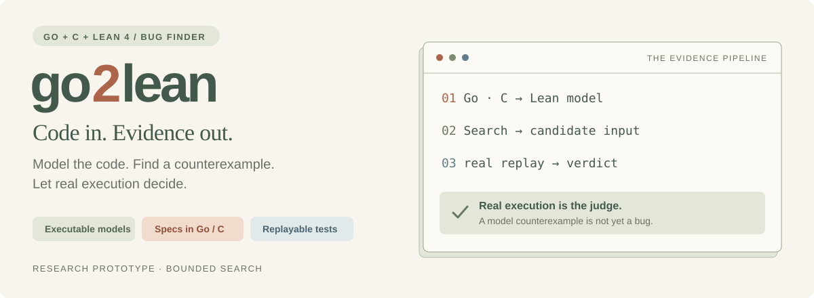
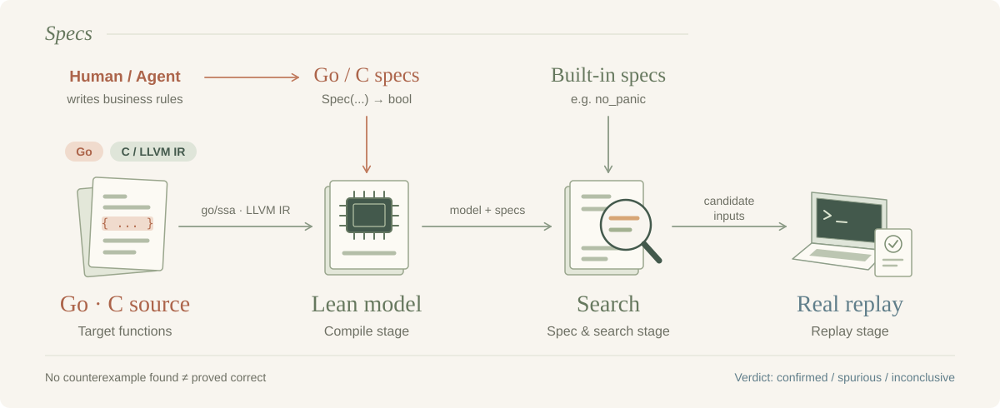

<h1 align="center">go2lean</h1>

<p align="center">
  <a href="#quick-start">Quick Start</a> ·
  <a href="#features">Features</a> ·
  <a href="#how-it-works">How It Works</a> ·
  <a href="#writing-a-spec">Writing a Spec</a> ·
  <a href="#documentation">Documentation</a>
</p>

<p align="center">
  
  
  <a href="LICENSE"></a>
</p>

Find bugs in Go and C code by translating it into an executable semantic
model in Lean 4, searching that model for counterexamples, and verifying every
counterexample by running the real code. Two front ends feed one model: Go
(through `go/ssa`) and C (through LLVM IR, `go2lean llvm`). Built-in templates
provide safety properties; humans or an optional LLM agent write business
specs, in Go or in C. Lean finds the inputs; `go test` (Go) or a C program
under AddressSanitizer (C) is the judge.


> **Scope.** A bounded, search-based bug finder—not a guarantee of
> correctness. Tried on 35 open-source projects it had never seen
> ([runs](docs/eval/fifth-run.md)); it translates 72% of the standard
> library's functions completely ([audit](docs/eval/std-audit.md)). It has
> found 73 confirmed defects across 30 projects, 44 of them new
> ([findings](docs/findings.md)). The Go line is the mature one; the C line
> is a prototype that has found defects in cJSON and stb_image. See [limitations](docs/limitations.md) and
> [validation](docs/validation.md) for scope and evidence.

## Features

- **C through LLVM IR** — `go2lean llvm` models a C file or a
  multi-file library (heap, strings, `ctype`, `strtod`, floats), builds
  inputs from its C types, searches for memory errors and for violations of
  specs written in C, runs libFuzzer where the model's search stops, and
  replays every finding as a C program under AddressSanitizer
  ([C and LLVM IR](docs/usage.md#c-and-llvm-ir), [C specs](docs/usage.md#specs-in-c)).
- **Executable Go models in Lean 4** — translate Go through SSA into a
  fuel-bounded semantic model, with unsupported behavior made explicit.
- **Safety checks without handwritten specs** — automatically generate
  `no_panic` properties for eligible target functions, generic ones
  included (instantiated at simple type arguments: `Last[int]`).
- **Business rules written in Go** — express postconditions as ordinary
  `bool`-returning Go functions; compile them alongside the target and reuse
  them as oracles in real Go tests.
- **Counterexample search** — combine seeded random search guided by program
  constants with exhaustive enumeration of small domains; check sequence
  properties over bounded streams of calls.
- **Real Go replay** — turn candidate counterexamples into runnable tests and
  distinguish confirmed findings from spurious or inconclusive results.
  Package-local generated helpers travel with their replay artifacts. A
  spurious result caused by a dependency call the model skipped gets that
  call translated, and the search runs again
  ([refinement](docs/pipeline.md#refinement-loop)).
- **Concurrency bugs** — deadlocks, goroutine leaks and data races, found in
  the model and confirmed by `go test` (with `-race`, and the model's
  schedule replayed when Go's scheduler does not take it); for small
  configurations, a certificate that none occurs under any schedule. A
  harness's setup runs once, not in every trial and schedule.
- **Functional proofs** — `go2lean prove` states a function's contract from a
  postcondition (in Lean, or one of your Go specs) and proves it for every
  input and every value of each type the model does not know, with the
  dependencies' models linked in; loop invariants are written by the
  optional agent or by hand. A
  proof counts only when Lean's comparator accepts it against go2lean's own
  statement, in a sandbox, with a certificate ([trust model](docs/trust.md)).
- **User models** — a call the model does not look into (an SDK client, a
  cgo binding) can be given a model written in Go, in `.go2lean/models`,
  without changing go2lean ([usage](docs/usage.md#user-models)).
- **Optional spec-writing agent** — read source (a Go package, or a C file
  or library), propose and repair specs, run the pipeline, and report the
  verdicts. Given a published advisory it writes the specs that find that
  bug class and its siblings ([property catalog](docs/specs/README.md)).
  `go2lean mine` collects what specs are drafted from: the project's
  advisories and fix commits, the RFC sections its code cites, its
  documented contracts, and similar projects' advisories
  ([usage](docs/usage.md#mining-the-evidence)).
  The basic pipeline needs no API key.

## Quick start

Requires **Git, Go 1.26 and [elan](https://github.com/leanprover/elan)**.
The pinned Lean toolchain is fetched, and go2lean's Lean runtime built, on
the first run: a few minutes, once per machine. No LLM API key is needed.
The binary bundles its Lean sources and can be installed with
`go install github.com/fooexec/go2lean/cmd/go2lean@latest`; it does not
need a source checkout at runtime. From a Go module, use
`go2lean run ./...` (automatic templates are panic checks).
An [experimental explicit ordering mode](docs/builtins.md) supplies non-panic
laws for a selected comparator under documented role/domain assumptions.

```sh
git clone https://github.com/fooexec/go2lean.git
cd go2lean
go run ./cmd/go2lean run ./examples/overflow
```

The example checks that adding non-negative integers produces a non-negative
result. It finds an overflow counterexample, replays it in Go, and writes a
runnable test plus reproduction instructions to `out/poc/`. A run ends with
a summary: the violated specs and the panics a caller can reach, with their
PoCs, then a count of the rest (ranked in `out/summary.md`).

**Run against a scratch clone:** replay executes real code and may have side
effects. On Linux, [bubblewrap](https://github.com/containers/bubblewrap) is
required for isolated replay (together with `prlimit`); replay refuses an
implicit unconfined fallback. Run `go2lean doctor` to check the local Go/Lean
toolchains and sandbox capabilities, including proof-judge requirements.
Use `go2lean doctor -deps ./...` to also check the target's cached dependencies
offline, without compiling or running it.
The [installation regression](docs/validation.md#offline-dependency-diagnostics)
checks fresh Go caches and missing-then-provisioned external dependencies.
Builds still run outside the sandbox, so use trusted source and dependencies.
Sandboxed replay and agent Lean checks do not inherit host credentials from
the environment. Other readable host paths remain exposed; this is not a
complete host-secret boundary.

**C:** the same loop on a C file. Building it needs LLVM's development files
and the sanitizer runtime (`llvm-18-dev`, `libclang-rt-18-dev` on Ubuntu):

```sh
go build -tags llvm18 -o go2lean ./cmd/go2lean
./go2lean llvm examples/llvm/oob.c
```

It finds the off-by-one read in `sum` and the signed overflow in `avg`,
confirms both by running the code under AddressSanitizer and UBSan, and
shows that `max_of` has no undefined behaviour on any input it tries.
`-memory` keeps to memory errors, `-fuzz 60s` adds libFuzzer, and
`-lib 'src/*.c'` takes a library of several files.

See the [usage guide](docs/usage.md) for sample output, agent setup, command
options, and running against another module.

## How it works



1. **Compile stage** — translate Go source (`go/ssa`) or C source (LLVM IR),
   and optional specs, into an executable Lean model.
2. **Spec & search stage** — check built-in safety properties and business
   specs, using seeded random search and small-domain exhaustive search;
   on C, libFuzzer then runs the real code where the model's search stops.
3. **Replay stage** — run candidate inputs as real code (`go test` for Go, a C
   program under AddressSanitizer for C) and report **confirmed**,
   **spurious**, or **inconclusive**, with replayable artifacts.

No counterexample found does **not** mean proved correct. The optional agent
writes specs; it does not replace model search or real execution.
[Pipeline details and proof boundaries →](docs/pipeline.md)

## Writing a spec

Built-in `no_panic` checks need no spec code, and neither does
`no_hang`. A function with a loop gets a `no_hang` check: a run that
comes back to a state it was in is a counterexample, replayed under a
watchdog ([details](docs/semantics.md#3-failure)). Both are checked on the
package's exported functions and methods; `-unexported` adds the others.
`-specs-only` skips both templates and searches only your specs. For a business rule, write an
ordinary Go function in the target package—yourself or with the agent:

```go
// go2lean:spec Sum
func SpecSum(xs []int, ret int) bool {
    for _, x := range xs {
        if x < 0 {
            return true // This rule only constrains non-negative inputs.
        }
    }
    return ret >= 0
}
```

The annotation associates the spec with `Sum`; its arguments are the target's
inputs followed by its result. Returning `false` violates the rule. The same
spec is compiled into Lean and checked again in Go during replay.

Why a business spec? Integer overflow wraps without panicking, so `no_panic`
alone would miss it. [More about specs →](docs/pipeline.md#writing-a-spec)

## Validation

The project checks known-bug examples, compares model behavior with real Go,
and records real-world case studies. CI pins expected regression outcomes and requires real replay coverage for
every differential property and requested seed;
these checks are evidence, not a general correctness guarantee.

**Concurrency, on GoKer** (the kernel half of GoBench: 103 small programs
extracted from real concurrency bugs in Kubernetes, etcd, gRPC, Docker,
CockroachDB and others). With each kernel's test as the target, go2lean
finds and `go test` confirms the bug in **60 of the 68 blocking kernels**
(deadlocks, goroutine leaks) and **27 of the 35 non-blocking ones** (24 of
them data races), with 4 spurious results across all 103
([details](docs/concurrency.md#goker)). About 6 of the blocking bugs show
up in Go only with the model's schedule replayed. GoKer is small (a median of 86 lines a kernel) and dates from 2021.

**Concurrency, on recent bugs in real projects** (25 fixed since 2023 in
grpc-go, sarama, prometheus, nats, containerd and others; both tools search
the same concurrent harness): go2lean found **6**, Go's fuzzer under
`-race` found **22**, and go2lean found none the fuzzer missed. go2lean's
misses were gaps in its model of the code around the bug (sockets, atomics,
standard-library calls it did not translate, runs out of fuel). Rerun after
fixing the first of them, go2lean found **10**, then **11**, then **12**; with
large arrays updated in place it also finds k016 at the default budget
([details](docs/eval/conc-recent.md#rerun-at-main-2026-10-30),
[rerun 6](docs/eval/conc-recent.md#rerun-of-the-fuel-cases-after-in-place-arrays-2026-11-05),
[roadmap](https://github.com/fooexec/go2lean/issues/53)).

[All findings](docs/findings.md) ·
[Property catalog](docs/specs/README.md) ·
[Validation and regression cases](docs/validation.md) ·
[semver evaluation](docs/eval/semver.md) · [glob evaluation](docs/eval/glob.md) ·
[proofs on real code](docs/eval/prove-blind.md) ·
[proofs on panic fixes](docs/eval/prove-fixes.md) ·
[concurrency evaluation](docs/eval/conc.md) ·
[what defects Go code has](docs/eval/go-defects.md) ·
[go2lean's search against fuzzing](docs/eval/search-vs-fuzz.md) ·
[recent concurrency bugs](docs/eval/conc-recent.md) ·
[grpc-go](docs/eval/grpc.md) ·
[runs on unseen projects](docs/eval/first-run.md) ([second](docs/eval/second-run.md), [third](docs/eval/third-run.md), [fourth](docs/eval/fourth-run.md), [fifth](docs/eval/fifth-run.md), [sixth](docs/eval/sixth-run.md), [seventh](docs/eval/seventh-run.md), [eighth](docs/eval/eighth-run.md), [ninth](docs/eval/ninth-run.md), [tenth](docs/eval/tenth-run.md), [eleventh](docs/eval/eleventh-run.md), [twelfth](docs/eval/twelfth-run.md), [thirteenth](docs/eval/thirteenth-run.md)) and [specs from security advisories](docs/eval/cve-specs.md) ·
[how much of the standard library it translates](docs/eval/std-audit.md) ([translating more of it](docs/eval/std-translation.md))

## Documentation

| Topic | Details |
|---|---|
| [Usage guide](docs/usage.md) | Agent setup, commands, real modules, C / LLVM |
| [Findings](docs/findings.md) | Every defect found in other projects, with severity and upstream status |
| [Property catalog](docs/specs/README.md) | Security properties written once (redirect, CORS, path normalization, C memory safety...), checked on any project |
| [Releases](docs/releases/README.md) | Weekly releases (Sundays) and the [changelog](CHANGELOG.md) |
| [Pipeline & specs](docs/pipeline.md) | Model construction, search, replay, spec examples |
| [Spec skill](.claude/skills/go2lean-spec/SKILL.md) | For an agent: what to check in a repo, which oracle, reading verdicts, the model-gap ledger |
| [Go support](docs/reference.md#supported-go-subset) | Supported constructs and library models |
| [Semantics](docs/semantics.md) | How faithfully the model follows Go |
| [Limitations](docs/limitations.md) | Unsupported behavior and trust boundaries |
| [Proof trust](docs/trust.md) | What a `proved` record asserts, and what it rests on |
| [Validation](docs/validation.md) | Regression cases, reproducibility, evaluation evidence |
| [Project reference](docs/reference.md) | Repository layout and roadmap |
| [Design](docs/design.md) | Architecture and technical decisions |
| [Concurrency](docs/concurrency.md) | Concurrent Go modeling and its limits |
| [Experimental ordering checks](docs/builtins.md) | Explicit opt-in, frozen bindings, real-project finding and remaining release gates |
| [Related work](docs/related-work.md) | Context and comparisons |

## License

MIT, see [LICENSE](LICENSE).
